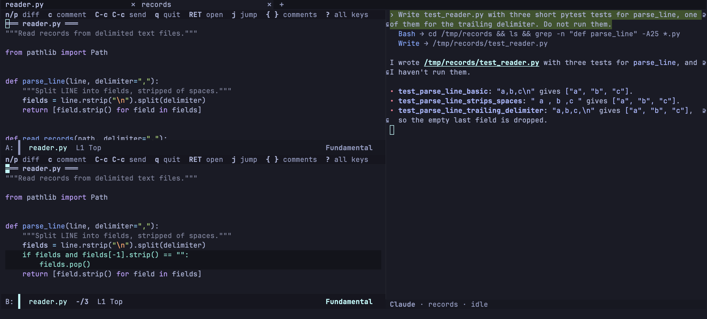

import Video from '../../../components/Video.astro';

`ecc-review-style` decides how the reviews of the [review menu](/emacs-claude-code/features/review/#choosing-what-to-compare) open. The default, `'diff`, is the diff buffer. `'ediff` shows the two sides in ediff:

```elisp
(setq ecc-review-style 'ediff)
```

`-e` in the menu switches the style for one review.

Every file of the review is in one ediff session: the old contents in one window, the new ones in the other, each file under a `═══ path ═══` line. A binary file, or one larger than `ecc-review-max-bytes`, is only its separator line. Both sides are read-only, so ediff's copy commands do nothing; you comment and send, and Claude edits the files.

The review takes the whole frame; set `ecc-review-ediff-full-frame` to `nil` to open it among the windows on the screen. `C-c C-k` and `q` give back the windows you had before; sending leaves the review open.

## The layout

The review opens with the old side above the new one and Claude's [reply pane](#the-reply-pane) beside them, at the bottom when the frame is too narrow to put it on the right.



Each window's header line lists keys. The mode line shows the file the cursor is in; the lower or right window's mode line also shows where you are, such as `3/12`. The ediff control panel is hidden; `?` shows it with every key and hides it again. Other ediff sessions keep your own window layout.

Each file is colored as its major mode colors it, and the words that changed are bold.

`|` puts the sides side by side with the pane under them, and `|` again stacks them:

<Video name="ediff-layout" label="The two sides of an ediff review turned from one above the other to side by side with |, and back" />

To open side by side:

```elisp
(setq ecc-review-ediff-layout 'side-by-side)   ; the default is 'stacked
```

## Reading in the two windows

The keyboard starts in the new side. Every key works in both windows, and digits give a count: `3j` jumps to the third difference.

<Video name="ediff-move" label="n and p moving through the differences of an ediff review from one file into the next, and the other side following the cursor line for line" />

Moving point drives the review. When point enters a difference, it becomes the current one, and the other window scrolls so that the matching line is on the same row. `n` and `p` go to the next difference below point or the previous one above it, from one file into the next. Scrolling one window with `C-v` or the mouse does not move the other; `v` and `V` scroll both, and `C-l` lines them up again.

`RET` opens the file at the line point is on, as the file is now, in a frame of its own. The review keeps its frame and the keyboard.

## Commenting

`c` comments on the line at point: in the old window on the line as it was, in the new one on the line as it is. `c` on a line both sides share has nothing to comment on, and says so.

<Video name="ediff-comment" label="c on an added line of the new side and on a replaced line of the old side, each comment appearing under its line" />

In the panel that `?` shows, `c` comments on the current difference, or replies to Claude's latest comment there. Comments, sending and [following the files](/emacs-claude-code/features/review/#following-the-files) work as in the diff buffer; the review keeps the current difference and the place of each side.

| Key | Action |
|---|---|
| `c` | In a window, comment on the line at point. In the panel that `?` shows, comment on the current difference, or reply to Claude's latest comment there. Again to edit |
| `{` / `}` | Previous / next comment |
| `l` | Jump to a comment |
| `x` | Remove a comment on the line at point, else on the current difference (`C-u x`: any comment). It is `d` in the diff buffer |
| `a` | Show or hide Claude's comments |
| `n` / `p` / `j` | Next or previous difference, or the numbered one |
| `v` / `V` | Scroll both windows |
| `RET` | Open the file in a frame of its own |
| `s` / `/` | [List or filter the files](/emacs-claude-code/features/review/#listing-and-filtering-the-files) |
| `T` / `t` / `M` | [Talk to Claude](/emacs-claude-code/features/review-claude/#talking-to-claude-from-the-review) |
| `u` / `d` | Scroll the reply pane back / on |
| `y` | Answer what Claude is waiting for, shown in the reply pane |
| `\|` | Stack the sides, or put them side by side |
| `!` | Read the files again (there is no `g`) |
| `]` / `[` | Next / previous commit of a [pull request](/emacs-claude-code/features/review/#a-pull-request-one-commit-at-a-time) |
| `C-c C-c` | Send the comments not sent yet as a prompt (`C-u C-c C-c` to edit it first) |
| `C-c C-a` | Send the comments of every commit of the pull request |
| `C-c C-k` | Drop the review and its comments |
| `q` | Quit the review |
| `?` | Show or hide the control panel |

## The reply pane

The session is out of sight while ediff has the frame. The pane shows the session's latest reply as it streams, one line for each tool call, colored as in the transcript:

<Video name="ediff-reply" label="T pressed in an ediff review, and Claude's tour streaming into the reply pane at the bottom, with a line for each tool it calls" />

Each turn replaces the last; the whole conversation stays in the transcript. The pane is never selected. `u` and `d` scroll it from the review; once you scroll back, it stops following the end until the end is in view again.

When Claude asks for permission, asks a question or has a plan to approve, the pane shows the request and `y` answers it, without leaving the review:

<Video name="ediff-permission" label="A message sent with M, Claude asking in the reply pane to edit the file, y allowing it, and the review reading the changed file again" />

| Variable | Default | Description |
|---|---|---|
| `ecc-review-talk-reply-width` | `75` | Width of the pane on the right. In a frame too narrow to leave the diff 80 columns, the pane goes to the bottom |
| `ecc-review-talk-reply-height` | `12` | Height of the pane at the bottom; `nil` turns the pane off |
| `ecc-review-talk-reply-place` | `'auto` | `'frame` puts the pane in a frame of its own for each review, which never takes the focus |
